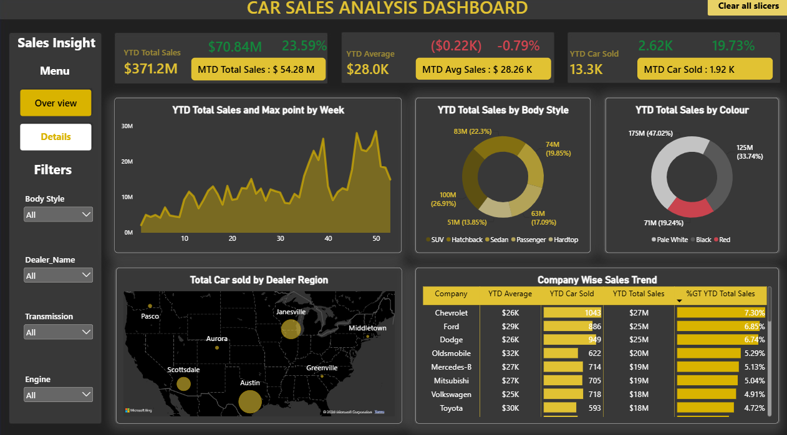
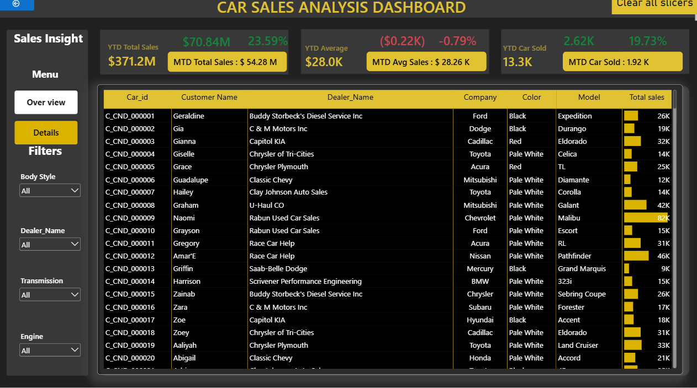

# Car-Sales-Analysis-Dashboard_Power-BI
Interactive Car Sales Analytics Dashboard built using Power BI to monitor sales performance, analyze revenue trends, evaluate dealer performance, and explore vehicle sales by company, body style, color, and region.

  

  

[▶️ Watch Car Sales Analysis Dashboard Demo](https://github.com/Chemical17/Car-Sales-Analysis-Dashboard_Power-BI/blob/266f02ba73d5847861ce5f5a2c4424293b0dc2d9/Car%20Sales%20com%20Video.mp4)
